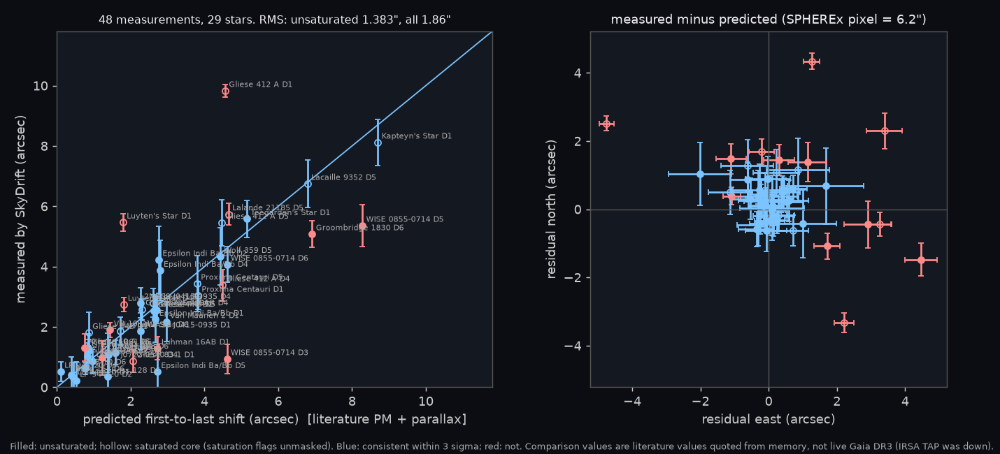

# SkyDrift

Enter a sky position and watch SPHEREx images of that patch blink across visits, so anyone
can spot moving or changing objects. Built for NASA Space Apps 2026 ("Planet X and SPHEREx").

- **Wavelength-fair blink.** SPHEREx sees each spot at a different wavelength in every
  exposure, so a naive blink flickers for that reason alone. SkyDrift stacks each detector
  per visit (inverse-variance weighted), so only real changes show.
- **Modes:** visit blink, single-exposure blink (with the wavelength shown), add (all epochs),
  subtract (visit A minus visit B).
- **Presets:** Barnard's Star, Epsilon Indi B, WISE 0855-0714, RW Aurigae, R Draconis.

Static showcase: open `docs/index.html` through any static web server (for example
`python -m http.server -d docs`). It runs the same frontend on pre-built preset data.

## Automatic candidates

For every detector with at least two visits, SkyDrift finds sources in each visit stack and
matches the first and last visits. It removes the field's median offset, then flags:
- **Movers:** a shift above 5σ, where σ combines centroid error and field scatter. A mover is
  confirmed when the difference image shows a +/− pair.
- **Variables:** a flux change above 5σ relative to the field, claimed only when the two visits
  cover overlapping wavelengths.

For a preset, the target itself is always measured against its literature proper motion.
Candidates are not discoveries.

## Spectrum on click

Click any source in the live app. SkyDrift measures it in every exposure from all six detectors:
- aperture photometry with radius 12", with local background removed;
- wavelength from each exposure's spectral WCS, errors from VARIANCE;
- results in µJy, plotted against wavelength (0.75-5 µm) and coloured by visit;
- flagged points greyed, with guide lines at water ice 3.0, CH4 3.3, CO2 4.27 and CO 4.67 µm;
- a per-visit light curve underneath.

If the source is a confirmed mover, the aperture follows its measured motion. In the static
showcase, spectra are precomputed for the field centre and the marked candidates. The 12"
aperture blends any source within ~15", and the panel says so.

## Truth check



`scripts/truth_check.py` measures known nearby high-proper-motion stars with the same pipeline.
It compares their first-to-last-visit shift with the prediction from proper motion plus parallax.
The full table is at `/validation`. **Caveat:** IRSA's Gaia DR3 service was unreachable during the
build, so the comparison values are literature numbers quoted from memory, and outliers are kept
rather than dropped. Saturated stars are excluded automatically.

## Run locally

```
python -m venv .venv
.venv/Scripts/python -m pip install -r requirements.txt     # Windows; use .venv/bin/ on macOS/Linux
.venv/Scripts/python -m app.server                          # http://127.0.0.1:8000/
.venv/Scripts/python export_showcase.py                     # rebuild docs/
.venv/Scripts/python -m pytest                              # tests
```

The server binds to 127.0.0.1 only. There are no analytics or trackers.

## How the data is found

The SPEC's route is IRSA's TAP service. That service (and SIA and cone search) was down
IRSA-wide during the build, so the default path is:

1. List IRSA's public SPHEREx bucket on AWS (`nasa-irsa-spherex`, anonymous). Read each
   candidate file's header with a small HTTP range request to find the exposures whose
   footprint contains the target. This is a sampled search, so it may miss some exposures.
2. Fetch only the pixels needed from the IRSA cutout service
   (`https://irsa.ipac.caltech.edu/ibe/data/spherex/<key>?center=..&size=..`).

At startup SkyDrift probes TAP once with a short timeout. If TAP answers, it uses the TAP
query instead. New releases (`dr*`, `qr*` prefixes) and new planning periods are picked up
automatically: DR is preferred over QR, and newer over older.

Pixel masking follows the SPHEREx Explanatory Supplement's list of "flags for masking pixels
for photometry" (HOT, COLD, NONFUNC, PERSIST, NONLINEAR, ...). The informational SOURCE flag
is not masked.

## Updating for new data releases

Nothing is hard-coded to a release or a date:
- The S3 path lists the bucket's `dr*` and `qr*` prefixes and planning periods on every scan.
  It takes each period from the best release that has it (DR before QR, newer before older) and
  merges reprocessed (`*_retry*`) directories.
- The TAP path, used automatically when TAP answers, queries `spherex.plane` with no date filter.
- To pick up new data:
  1. Run `python scripts/coverage_daemon.py --minutes 60` (or `--until HH:MM`).
  2. Run `python scripts/refresh.py`, which rebuilds views, candidates and the truth check, then
     exports `docs/`.

Cached views rebuild themselves when the coverage index holds more exposures than they were
built from.

## Network calls

- **Server side only:**
  - `https://irsa.ipac.caltech.edu/TAP/sync`: one probe at startup; queries only if it answers.
  - `https://irsa.ipac.caltech.edu/ibe/data/spherex/...?center=&size=`: IRSA cutout service.
  - `https://nasa-irsa-spherex.s3.us-east-1.amazonaws.com/`: IRSA's public SPHEREx bucket,
    anonymous listing and header range reads.
  - PyPI, for installing dependencies.
  - At most 10 parallel workers, with timeouts and backoff.
- **Browser:** none. The page loads only its own files. There are no analytics, trackers,
  fonts or CDNs.
- **One-off, during development only:** IRSA documentation pages (the Explanatory Supplement
  PDF and the mission page) were read for flag meanings and credits. The app never calls them.

## Data & credits

- **SPHEREx / IRSA.** This publication makes use of data products from the Spectro-Photometer for
  the History of the Universe, Epoch of Reionization and Ices Explorer (SPHEREx), which is a
  joint project of the Jet Propulsion Laboratory and the California Institute of Technology, and
  is funded by the National Aeronautics and Space Administration. (Acknowledgement text from
  IRSA's SPHEREx page.)
- **IRSA.** Data obtained from the NASA/IPAC Infrared Science Archive (IRSA), operated by the
  Jet Propulsion Laboratory, California Institute of Technology, under contract with NASA.
- **References.**
  - SPHEREx Explanatory Supplement (IRSA, SSDC-DP-017 v2.0), for the FLAGS definitions.
  - "The SPHEREx Satellite Mission", ApJ 999, 139 (2026), doi:10.3847/1538-4357/ae2be2.
  - "The SPHEREx Image and Spectrophotometry Processing Pipeline", ApJS 285, 67 (2026),
    doi:10.3847/1538-4365/ae8843.
  - SPHEREx data used: Data Release 1 (DR1) and Quick Release 3 (QR3) spectral images, accessed from
    IRSA's public archive. Please cite SPHEREx data using the acknowledgement and DOI guidance on
    IRSA's SPHEREx pages (irsa.ipac.caltech.edu).
- **Comparison values.** The proper motions and parallaxes for the truth check and the presets
  are literature values. They were not queried live from Gaia DR3 (ESA), because IRSA's Gaia
  service was down. Replace them from Gaia DR3 when it is reachable.
- **No NASA logos, insignia or mission patches** are used anywhere.
- SkyDrift code is released under the MIT license (see LICENSE).

## Library licenses

| Library | License |
|---|---|
| astropy | BSD-3-Clause |
| astroquery | BSD |
| pyvo | BSD-3-Clause |
| numpy | BSD-3-Clause (+ bundled 0BSD/MIT/Zlib/CC0 parts) |
| scipy | BSD |
| reproject | BSD-3-Clause |
| sep | LGPL-3.0-or-later |
| pillow | MIT-CMU |
| imageio | BSD-2-Clause |
| imageio-ffmpeg | BSD-2-Clause (bundled ffmpeg binary: its own GPL/LGPL license; used only to make demo MP4s) |
| matplotlib | Matplotlib license (PSF-based) |
| requests | Apache-2.0 |
| fastapi | MIT |
| uvicorn | BSD-3-Clause |
| pytest | MIT |
| httpx | BSD-3-Clause (tests only) |
| pypdf | BSD-3-Clause (used once to read the Explanatory Supplement; not needed at runtime) |

## AI disclosure

This project was built with AI assistance (Claude Code). Every source file says so in its
header. See `AI_USAGE.md`; the specification and selected prompts are in `docs/prompts/`.
